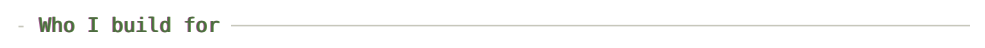
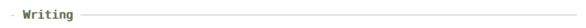
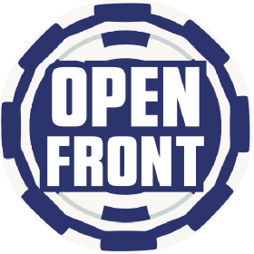
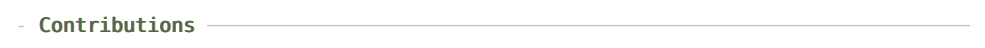

<a href="https://github.com/Kronbii/Kronbii">
  <picture>
    <source media="(prefers-color-scheme: dark)" srcset="https://raw.githubusercontent.com/Kronbii/Kronbii/main/dark_mode.svg">
    
  </picture>
</a>

<!-- links:start -->
<a href="https://ramikronbi.com"><picture><source media="(prefers-color-scheme: dark)" srcset="assets/parts/link-ramikronbi-com-dark.svg"></picture></a>
<a href="https://linkedin.com/in/rami-kronbi"><picture><source media="(prefers-color-scheme: dark)" srcset="assets/parts/link-linkedin-dark.svg"></picture></a>
<a href="https://www.youtube.com/@RamiKronbi"><picture><source media="(prefers-color-scheme: dark)" srcset="assets/parts/link-youtube-dark.svg"></picture></a>
<a href="https://instagram.com/ramikronbi"><picture><source media="(prefers-color-scheme: dark)" srcset="assets/parts/link-instagram-dark.svg"></picture></a>
<a href="https://dev.to/ramikronbi"><picture><source media="(prefers-color-scheme: dark)" srcset="assets/parts/link-dev-dark.svg"></picture></a>
<a href="https://medium.com/@ramikronbi"><picture><source media="(prefers-color-scheme: dark)" srcset="assets/parts/link-medium-dark.svg"></picture></a>
<a href="https://substack.com/@kronbii"><picture><source media="(prefers-color-scheme: dark)" srcset="assets/parts/link-substack-dark.svg"></picture></a>
<a href="mailto:ramykronby@gmail.com"><picture><source media="(prefers-color-scheme: dark)" srcset="assets/parts/link-email-dark.svg"></picture></a>
<!-- links:end -->

 

<picture><source media="(prefers-color-scheme: dark)" srcset="assets/parts/section-who-i-build-for-dark.svg"></picture>

<table>
  <tr>
    <td width="190"><b>People who sign</b></td>
    <td><a href="https://ramikronbi.com/projects/omnisign-lebanese-sign-language"><b>OmniSign</b></a> Recognizes Lebanese Sign Language from a camera in real time, the alphabet and everyday words, and turns it into text on phones, the web, and offline devices.</td>
  </tr>
  <tr>
    <td><b>Children with autism</b></td>
    <td><a href="https://ramikronbi.com/projects/emotion-recognition-autism-support"><b>Edge emotion recognition</b></a> Reads facial expressions in real time on a small device, as a support tool for children with autism.</td>
  </tr>
  <tr>
    <td><b>Students</b></td>
    <td><a href="https://ramikronbi.com/projects/posture-aware-classroom-desk"><b>BEMO, the smart interactive desk</b></a> A desk that sees how you sit and adjusts its own height and tilt, with instant light feedback and a dashboard of longer-term patterns.</td>
  </tr>
  <tr>
    <td><b>Demining</b></td>
    <td><a href="https://ramikronbi.com/projects/landmine-detection-extraction-robot"><b>Landmine detection and extraction robot</b></a> A mine-detection rover with a 6-DoF extraction arm, for a Lebanese Army initiative; I built its autonomy software.</td>
  </tr>
  <tr>
    <td><b>Road safety</b></td>
    <td><a href="https://ramikronbi.com/projects/road-speed-audit"><b>Road-speed audit</b></a> Measures how fast cars drive on one street from a single camera, and says how far each number can be trusted.</td>
  </tr>
</table>

 

<picture><source media="(prefers-color-scheme: dark)" srcset="assets/parts/section-writing-dark.svg"></picture>

<!-- writing:start -->
- <a href="https://ramikronbi.com/writing/engineering-a-five-inch-fpv-drone-from-first-principles"><b>Engineering a five-inch FPV drone from first principles</b></a> Building a five-inch FPV drone is an exercise in coupled constraints: every part you choose changes what the others have to do.
- <a href="https://ramikronbi.com/writing/building-a-360-panorama-stitcher-from-a-phone-sweep"><b>Building a 360° panorama stitcher from a phone sweep</b></a> A phone video, a pure-rotation camera model, and a stubborn question: how much of a 360° reconstruction pipeline can be made explicit instead of hidden behind a stitching API?
- <a href="https://ramikronbi.com/writing/designing-a-pid-library-for-real-embedded-control"><b>Designing a PID library for real embedded control</b></a> The PID equation is short. A controller that behaves predictably on an Arduino needs much more than three gains.
- <a href="https://ramikronbi.com/writing/building-an-autonomous-race-car-in-twenty-days"><b>Building an autonomous race car in twenty days</b></a> A small autonomous vehicle forced perception, control, power, mechanics, and team decisions into one unforgiving loop.
<!-- writing:end -->

<a href="https://ramikronbi.com/writing">All writing on ramikronbi.com</a> · <a href="https://ramikronbi.com/feed.xml">RSS</a>

 

<picture><source media="(prefers-color-scheme: dark)" srcset="assets/parts/section-open-source-dark.svg"></picture>

<table>
  <tr>
    <td width="50" align="center">
      
    </td>
    <td>
      <b>Arduino Library Manager</b> 
      Author of <a href="https://github.com/Kronbii/easyPID"><b>easyPID</b></a>, a production-grade multi-instance PID controller library for embedded systems
    </td>
  </tr>
  <tr>
    <td width="50" align="center">
      
    </td>
    <td>
      <b>Betaflight</b> 
      Contributor to the open-source flight controller firmware project
    </td>
  </tr>
  <tr>
    <td width="50" align="center">
      
    </td>
    <td>
      <b>OpenFront</b> 
      Contributor to the open-source real-time strategy game
    </td>
  </tr>
</table>

 

<picture><source media="(prefers-color-scheme: dark)" srcset="assets/parts/section-contributions-dark.svg"></picture>

  <picture>
    <source media="(prefers-color-scheme: dark)" srcset="assets/flight-dark.svg">
    
  </picture>

