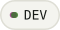
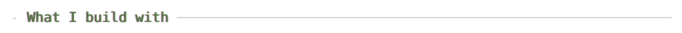
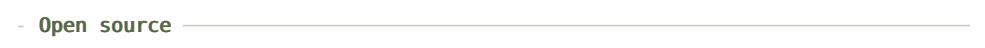
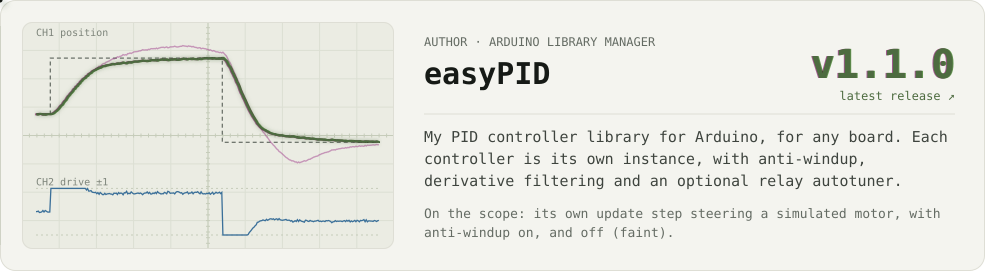
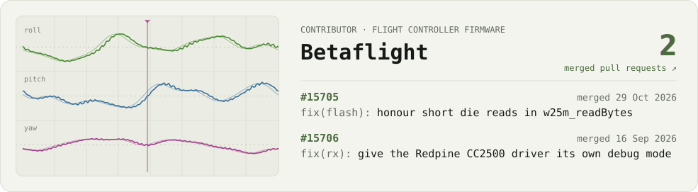

<a href="https://github.com/Kronbii/Kronbii">
  <picture><source media="(prefers-color-scheme: dark)" srcset="assets/sight-dark.svg"></picture>
</a>

<picture><source media="(prefers-color-scheme: dark)" srcset="assets/parts/headline-dark.svg"></picture>

<!-- links:start -->
<a href="https://ramikronbi.com"><picture><source media="(prefers-color-scheme: dark)" srcset="assets/parts/link-ramikronbi-com-dark.svg"></picture></a>
<a href="https://linkedin.com/in/rami-kronbi"><picture><source media="(prefers-color-scheme: dark)" srcset="assets/parts/link-linkedin-dark.svg"></picture></a>
<a href="https://www.youtube.com/@RamiKronbi"><picture><source media="(prefers-color-scheme: dark)" srcset="assets/parts/link-youtube-dark.svg"></picture></a>
<a href="https://instagram.com/ramikronbi"><picture><source media="(prefers-color-scheme: dark)" srcset="assets/parts/link-instagram-dark.svg"></picture></a>
<a href="https://dev.to/ramikronbi"><picture><source media="(prefers-color-scheme: dark)" srcset="assets/parts/link-dev-dark.svg"></picture></a>
<a href="https://medium.com/@ramikronbi"><picture><source media="(prefers-color-scheme: dark)" srcset="assets/parts/link-medium-dark.svg"></picture></a>
<a href="https://substack.com/@kronbii"><picture><source media="(prefers-color-scheme: dark)" srcset="assets/parts/link-substack-dark.svg"></picture></a>
<a href="mailto:ramykronby@gmail.com"><picture><source media="(prefers-color-scheme: dark)" srcset="assets/parts/link-email-dark.svg"></picture></a>
<!-- links:end -->

 

<picture><source media="(prefers-color-scheme: dark)" srcset="assets/parts/section-where-i-work-dark.svg"></picture>

<!-- work:start -->
<a href="https://oreyeon.com"><picture><source media="(prefers-color-scheme: dark)" srcset="assets/parts/work-oreyeon-dark.svg"></picture></a>
 
<a href="https://cnrs.edu.lb"><picture><source media="(prefers-color-scheme: dark)" srcset="assets/parts/work-cnrs-l-dark.svg"></picture></a>
<!-- work:end -->

 

<picture><source media="(prefers-color-scheme: dark)" srcset="assets/parts/section-what-i-build-dark.svg"></picture>

<picture><source media="(prefers-color-scheme: dark)" srcset="assets/reel-dark.svg"></picture>

<!-- who:start -->
<a href="https://ramikronbi.com/projects/landmine-detection-extraction-robot"><picture><source media="(prefers-color-scheme: dark)" srcset="assets/parts/who-landmine-detection-and-extraction-robot-dark.svg"></picture></a>
<a href="https://ramikronbi.com/projects/omnisign-lebanese-sign-language"><picture><source media="(prefers-color-scheme: dark)" srcset="assets/parts/who-omnisign-dark.svg"></picture></a>
<a href="https://ramikronbi.com/projects/posture-aware-classroom-desk"><picture><source media="(prefers-color-scheme: dark)" srcset="assets/parts/who-bemo-the-smart-interactive-desk-dark.svg"></picture></a>
<a href="https://ramikronbi.com/projects/five-inch-carbon-fiber-fpv-drone"><picture><source media="(prefers-color-scheme: dark)" srcset="assets/parts/who-5-inch-carbon-fiber-fpv-drone-dark.svg"></picture></a>
<!-- who:end -->

 

<picture><source media="(prefers-color-scheme: dark)" srcset="assets/parts/section-what-i-build-with-dark.svg"></picture>

<picture><source media="(prefers-color-scheme: dark)" srcset="assets/explode-dark.svg"></picture>

 

<picture><source media="(prefers-color-scheme: dark)" srcset="assets/parts/section-lately-dark.svg"></picture>

<picture><source media="(prefers-color-scheme: dark)" srcset="assets/prism-dark.svg"></picture>

 

<picture><source media="(prefers-color-scheme: dark)" srcset="assets/parts/section-open-source-dark.svg"></picture>

<a href="https://github.com/Kronbii/easyPID"><picture><source media="(prefers-color-scheme: dark)" srcset="assets/upstream-easypid-dark.svg"></picture></a>
 
<a href="https://github.com/betaflight/betaflight/pulls?q=is%3Apr+author%3AKronbii"><picture><source media="(prefers-color-scheme: dark)" srcset="assets/upstream-betaflight-dark.svg"></picture></a>
 
<a href="https://github.com/openfrontio/OpenFrontIO/pulls?q=is%3Apr+author%3AKronbii"><picture><source media="(prefers-color-scheme: dark)" srcset="assets/upstream-openfront-dark.svg"></picture></a>

<a href="https://committers.top/lebanon"><picture><source media="(prefers-color-scheme: dark)" srcset="assets/upstream-rank-dark.svg"></picture></a>

 

<picture><source media="(prefers-color-scheme: dark)" srcset="assets/parts/section-contributions-dark.svg"></picture>

  <picture>
    <source media="(prefers-color-scheme: dark)" srcset="assets/flight-dark.svg">
    
  </picture>

